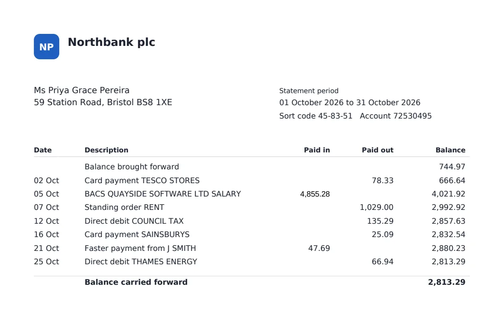
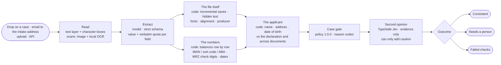
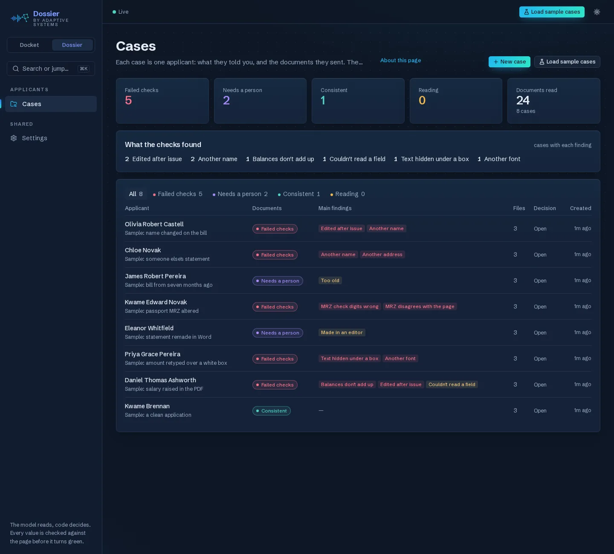
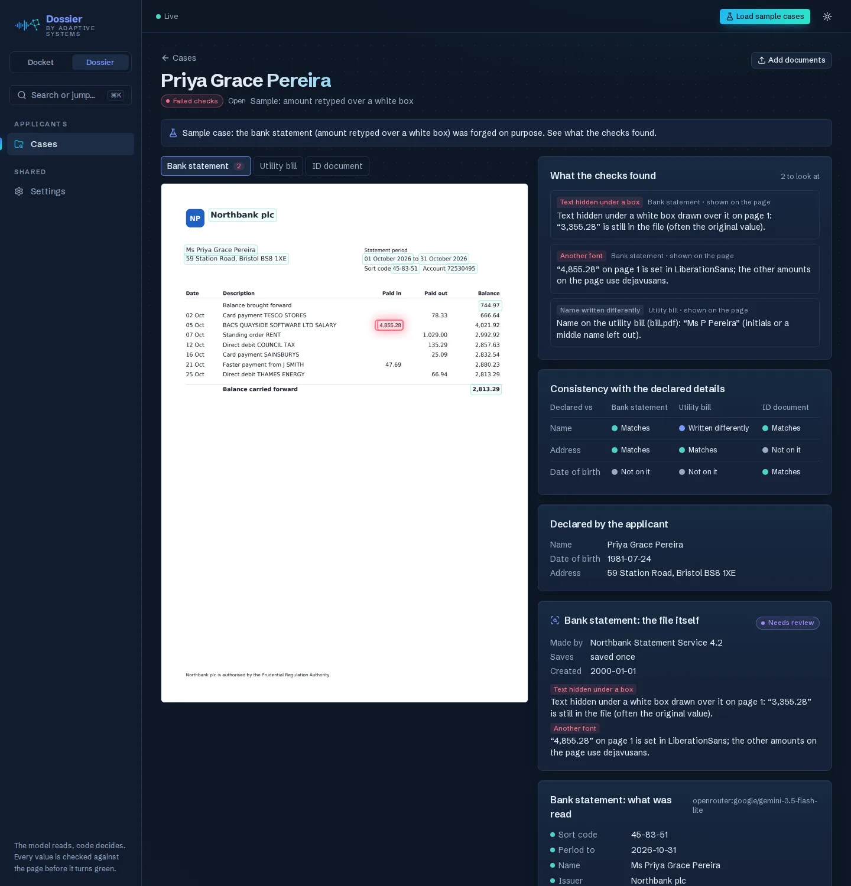

# Dossier — applicant documents, checked

> **Case study.** Dossier checks the documents an applicant gives a business (bank statements, utility and
> council tax bills, payslips, tax documents, passports and ID cards) against what the applicant declared and
> against each other. A model **reads** every value with the words it read; deterministic code **decides**: it
> examines each PDF for edits, adds up every balance, checks bank details and a passport's machine-readable zone,
> and compares every name, address and date of birth. The outcome is about the documents, never a score of the
> person: *consistent*, *needs a person* or *failed checks*, with every reason boxed on the page.
> Every number here was measured on the running system. The source code is private; this repository holds the
> case study.

  <b>Live:</b> <a href="https://adaptivesystems.dev/dossier">product page with live numbers</a> ·
  <a href="https://adaptivesystems.dev/dossier/try">forge an applicant yourself</a> ·
  <a href="https://adaptivesystems.dev/live#dossier">live activity</a> ·
  <a href="https://adaptivesystems.dev/one-pager">one-pager</a> ·
  <a href="https://adaptivesystems.dev/">adaptivesystems.dev</a> 
  <i>Runs on the <a href="https://github.com/adaptivesystemsdev/docket-invoice-intake">Docket</a> engine ·
  sibling of the <a href="https://github.com/adaptivesystemsdev/ai-command-center">Front Desk AI stack</a>.</i>

  
  
  

  

---

## Problem

A tenant, a borrower or a client under anti-money-laundering rules sends a bank statement, a bill and a copy of
a passport, and somebody looks at them. Forged statements are now cheap (template farms, PDF editors, generative
tools), and fraud teams name bank statements as the document they worry about most. The tools that catch this
are enterprise contracts; cheap identity suites read a proof of address but barely look inside the file. Small
lenders, brokers, letting agents, accountants and law firms sit in between with nothing but their eyes.

## Approach: the model reads, code decides

A model is good at reading a statement and bad at noticing that it was edited. So the model only reads; it
returns each value with the exact words it read and their line. Everything that decides is plain code you can
test, version and audit:

| Check | How |
|---|---|
| **Edited after issue** | a PDF saved again keeps its first version inside; Dossier compares the revisions and shows the change, e.g. `3,820.97 → 5,820.97` |
| **Text under a box** | text painted over with a white rectangle is still in the file: the hidden value is quoted (often the original) |
| **Another font, out of line** | an amount typed in a PDF editor rarely matches the issuer's font or the column's right edge |
| **Made in an editor** | Word, LibreOffice, online PDF editors or "print to PDF" as the producer of a bank statement |
| **Balances** | opening balance + money in − money out must equal every printed balance, row by row |
| **Bank details** | IBAN mod-97, UK sort code + account shape, US ABA routing checksum |
| **Passport / ID** | ICAO 9303 MRZ check digits, and the MRZ agreeing with the printed page |
| **Who and where** | names (initials, order and accents allowed; one changed letter is not), addresses by postcode and house number, dates of birth |
| **Used by someone else** | the same document in another applicant's case; documents unlike an issuer's earlier ones |
| **Fresh and valid** | proof of address within the recency window, IDs not expired, income consistent with the declaration |

Forensics are bounded (size, revisions, comparisons, time) and fail closed: a file too complex to verify says
so (`FORENSICS_INCOMPLETE`) instead of passing.

## The app

  

- **Cases:** one row per applicant, what they declared and the documents they sent; outcome and main findings
  at a glance; drop files on the list to start a new applicant with them.
- **Case view:** each document's page with every value boxed where it was read and every finding boxed where
  it is (red), the consistency matrix (declared details vs each document), the file's own story (producer,
  saves, hidden text, fonts), the second opinion, and a decision (accept / request a document / reject) that is
  logged with who and when.

  

- **Settings (its own, separate from Docket's):** the case policy (documents a case needs, how recent proof of
  address must be, expired IDs, income tolerance), team notifications, reading (OCR), retention, email intake
  and the public demo, each explained in place.
- **Sample cases:** one click creates a genuine applicant and seven forged ones to watch them get caught.

## Channels and outputs

- **Ask the applicant:** a private upload link per case (`/dossier/upload#t=…`): the applicant passes a quick human
  check per file and sends their documents straight into their case. They see who is asking, which documents the
  case needs and the files they sent, never what the checks found. Only a hash of the token is stored; links expire
  (1–30 days), take a fixed number of files, and stop when the case is decided or erased; a dead link answers the same
  404 whatever the reason. The token travels in the URL fragment and leaves the address bar before any analytics runs.
- **Upload or drop** onto a case or onto the list; PDFs, scans and phone photos.
- **By email:** forward an applicant's email to the intake address; a case is opened for it, or the documents
  join the case whose reference is in the subject (only from the team itself, or from that case's sender with a
  passing DKIM signature).
- **Signed webhooks:** `case.created`, `case.documents_added`, `case.evaluated`, `case.decided` (HMAC signature,
  retries, delivery log) into n8n, Zapier or a CRM; **CSV / JSON export** of every case (formula-safe CSV).
- **Team notifications:** Slack, Telegram or email when a case fails a check or needs a person: the case
  reference and initials only, never names, addresses or amounts.
- **Erasure:** one applicant at once on request, or every applicant past the retention period: documents purged
  (a file another applicant also sent stays as their evidence), the case keeps only its outcome, decision and dates,
  pending webhooks and notifications about it are cancelled and cleared.

## Measured

| Metric | Value | Notes |
|---|---|---|
| Forged packs caught | **40 / 40** | published eval 2026-11-02: 10 forgery types × 4 seeds through the production model and every check |
| False alarms | **0 / 4** genuine packs | same run: a genuine pack must come out *consistent* |
| Second opinion agrees | **42 / 44** packs | TypeSafe Jev on the same packs; raised the risk on 40 / 40 forged packs, sent **0 / 4** genuine packs to a person (noted a moderate doubt on 2) |
| Time per applicant pack | **median 8.1 s** | three documents read, examined and compared |
| Time per document | **≈ 4.2 s** read · **36 ms** forensics · **6 ms** checks | the statement shown above |

Forgery types in the eval: salary raised in the PDF · salary raised with every balance recalculated · amount
retyped over a white box (another font) · retyped in the statement's own font · statement remade in Word · name
changed on a bill · another applicant's statement · template-farm statement with broken balances · passport date
of birth altered in the MRZ · a seven-month-old bill. The live numbers (applicants checked, outcomes, what was
caught, the eval) are published at `https://adaptivesystems.dev/live/dossier/stats.json`; the activity feed is
built from fixed templates and never carries names, amounts, account numbers or file names.

Tests: **308** for the Docket + Dossier engine (pytest, mypy `--strict`, the model scripted), plus a forgery
generator that builds the eval's packs.

## Second opinion

After the checks, a separate decision model (TypeSafe Jev, the same overlay as Docket's documents and Front Desk's
leads) is asked how likely a forgery is. It sees **evidence only**: the kinds of documents, the reason codes and the
consistency counts, never a name, address, number, date or file. It is asked about every checked case and can
**only make the outcome stricter**: a strong "high risk" on a case whose checks all passed sends it to a person; on
a case a person sees anyway its view is recorded; it never clears a failed check. The app shows the risk band, its
probabilities, whether it agrees with the checks, the model, the timing and exactly what it saw, or why it wasn't
asked. Measured on the published eval above: it adds no false alarms, and (seeing only the checks' codes) it finds
nothing the checks miss. Its value is a cheap, independent sanity check on the decision, not a detector.

## Real statements

A genuine bank statement emailed in by the owner was flagged *balances don't add up*: a side panel printed beside
the rows ("Average credit balance £606.00") was read as row balances, two equal payments on one day were read as
one row, dates had no year. The fixes are general: code learns each money column's position from the values (the
position that lines up with the most row lines), keeps a printed figure with the one row it belongs to, checks
every figure printed in the balance column even if no row quoted it, and reports a row the reading skipped as such
(a person checks the rows) only when putting the skipped amount back makes every balance add up. All four model
readings of that statement now come out right, and the forgery eval is unchanged.

## Guardrails (by design)

- **Documents, not people.** The outcome says what is wrong with a document; a person decides about the
  applicant. No affordability score, no automated refusal (EU AI Act: creditworthiness scoring is high-risk,
  fraud detection is not).
- **No biometrics.** No selfie, face match or liveness check.
- **No authenticity claims for IDs.** The MRZ is checked; genuineness needs the chip or security features, which a
  certified identity partner checks.
- **Not a consumer report.** No US tenant screening (FCRA).
- **Privacy:** documents only go to model providers that don't store or train on them; alerts carry no personal
  data; the public demo uses synthetic applicants and erases every session after 30 minutes.

## What I learned

- A forgery that looks perfect on screen usually isn't perfect in the file: the saves, the fonts and the text
  under a box tell the story, and they are cheap to check in code.
- The comparison is the product. One document on its own says little; the same person, address and dates
  across three documents and a declaration say a lot.
- Measure false alarms as hard as detection. A checker that flags genuine applicants gets switched off.
- Synthetic packs are not enough. The first real statement found five reading problems the generator never made;
  each became a general rule and a regression test with made-up numbers.
- A second opinion that only sees your own reason codes can't find what the checks miss. Measure what it is for
  (agreement, no added false alarms) and say so.

---

Built by [Adaptive Systems](https://adaptivesystems.dev) · [contact](https://adaptivesystems.dev/contact?topic=dossier) ·
[hire us for a custom build](https://adaptivesystems.dev/contact?topic=custom)
